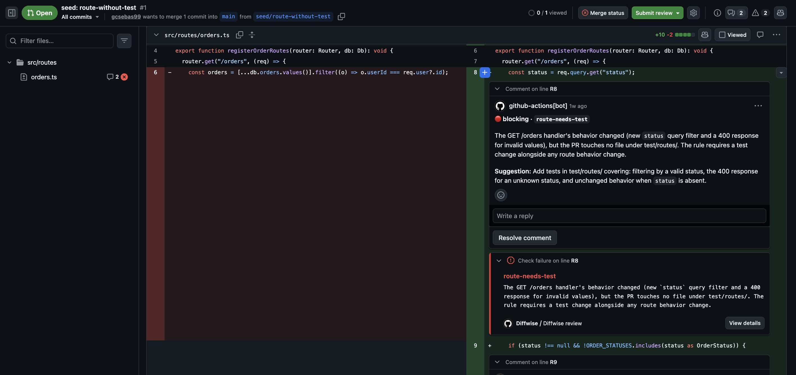
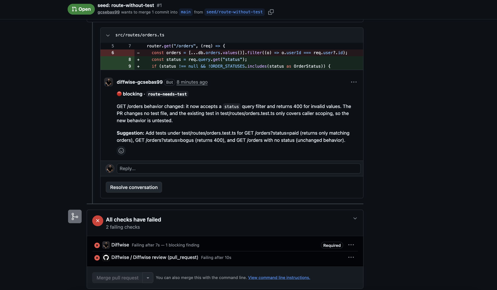
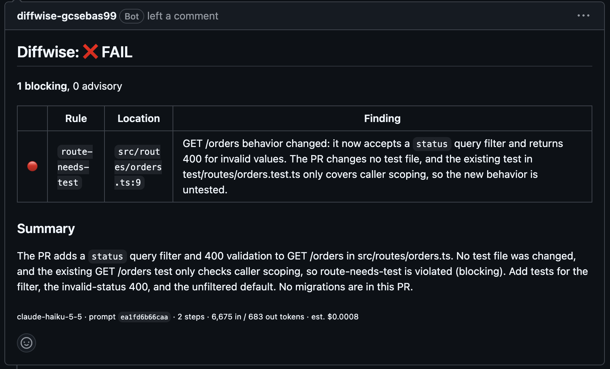
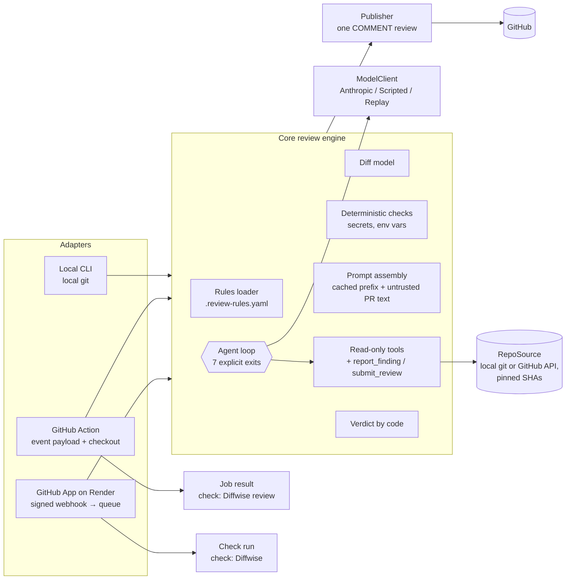

# Diffwise

Every team has review rules that live in people's heads: route changes need a test, migrations
need a rollback, tokens never get logged. On a busy day, reviewers miss them.

Diffwise is an AI agent that reviews pull requests against rules defined in the target repo
(`.review-rules.yaml`). It posts one review with inline comments and a summary, and the
**verdict is computed by code**: any `blocking` finding fails the check, so branch protection
can block the merge.

It ships two ways from one core engine: a **GitHub Action** that runs in the target repo's CI,
and a **GitHub App** (a webhook service on Render) that repos install with one click. The same
engine also runs as a local CLI.

**At a glance:** 18 eval cases, 54/54 trials passed on `claude-haiku-5-5` · about $0.0006 per
model review · rules that code can check run for $0, and moving them to the model added 52% cost
and 3 false positives ([ablation](docs/ablations.md)).

**Learning takeaways:** [`docs/learning-takeaways.md`](docs/learning-takeaways.md) collects what
building this taught, as questions and answers by theme, each pointing at the code.

**Live demo:** [gcsebas99/diffwise-demo](https://github.com/gcsebas99/diffwise-demo/pulls), six
seeded PRs: four blocked by Diffwise (one of them by a code check, no model call), one clean
refactor it passes, and one prompt injection it ignores.

| A failing review with an inline comment | The merge, blocked by the required check |
|---|---|
|  |  |



## How it works



1. **Rules** come from the target repo. Each has a severity (`blocking` / `advisory`) and either
   `check: llm` (the model judges it) or `check: deterministic:<name>` (code checks it).
2. **The agent loop** gives the model a map of the PR (files and the rules that apply), not the
   whole diff. It pulls hunks with tools, reads files or searches when a rule needs context, and
   calls `report_finding` for each violation. Code validates every finding: the rule must exist
   and apply to the file, and the line must be commentable in the diff.
3. **The loop always ends explicitly:** `submit_review`, or a step cap, token budget, deadline,
   stuck detection, a model that stops calling tools, or an API error. Only a submitted review
   is "complete"; anything else is `neutral`, never `pass`.
4. **The verdict:** a blocking finding → fail; incomplete → neutral; otherwise pass.
5. **The Action** posts one review pinned to the PR's head SHA, marks the previous Diffwise
   review outdated, writes annotations and a job summary, and fails the job on `fail`.

## One engine, three ways to run it

The core (`src/core/`) knows nothing about GitHub or the terminal. Each adapter gathers the
inputs (rules, a `RepoSource`, PR title and body) and delivers the result.

| | GitHub Action | GitHub App |
|---|---|---|
| Who runs it | GitHub's runner, inside the repo's CI | our server on Render |
| Setup per repo | a workflow file, a secret, a variable, a label | install the App, choose repos, add `.review-rules.yaml` |
| Anthropic key | each repo's own secret | one key on the server |
| Identity on PRs | `github-actions[bot]` | `diffwise-gcsebas99[bot]` |
| Permissions | the workflow's `GITHUB_TOKEN`: `contents: read`, `pull-requests: write` | fixed at registration; each review gets a token down-scoped to one repo |
| Reads the PR via | `git` on a checkout of the PR | the REST API at a pinned SHA; no clone |
| Rules read from | the PR's checkout | the **base** commit, so a PR can't edit its own rules |
| When the model runs | only with the `live-review` label | every PR with a model-checked rule, under a daily cap |
| Verdict shown as | the job's result | a check run, with annotations |
| Required check name | **`Diffwise review`** (source: GitHub Actions) | **`Diffwise`** (source: the App) |
| Upgrades | each repo bumps the version tag | deploy once, every repo gets it |
| Operations | none | uptime, cold starts, queue, idempotency, logs |

A team using it in their own repos would pick the Action: nothing to host. A product installed
across many repos and organizations is an App: one-click install, central keys, its own identity.

### Requiring the check: Action vs App

Branch protection (a ruleset with "Require status checks to pass") matches a required check by
**name and source**. The two adapters report different checks, so a repo must require the one it
actually runs:

- **Action:** the check is the workflow job, **`Diffwise review`**, reported by **GitHub Actions**.
  It needs the workflow enabled (and the secret and variable for live mode). It goes red when the
  job fails, which the action does on a `fail` verdict.
- **App:** the check is a check run, **`Diffwise`**, reported by the **App**. It needs the App
  installed on the repo and the service running. Require it with the App as its source, so no
  other integration can satisfy it with a fake `Diffwise` status. It's `success`, `failure`,
  `neutral` (the review didn't finish, or the daily cap was reached) or `skipped` (no rules file).

A required check that nothing reports stays **"Expected — waiting for status to be reported"** and
blocks the merge forever: requiring the Action's check while only the App runs (or the other way
round) leaves every PR waiting on a check that never arrives. Require only the check of the path
you use; requiring both means running both, and paying for two reviews. The demo repo uses the
App: its ruleset on `main` requires **`Diffwise`** from the App, and its workflow stays in the
repo, disabled, as the Action example.

## How it compares

Diffwise is a learning project, not a product. These are the closest tools that do this at
scale, and the ones worth using if you want this in production:

| | Diffwise | [CodeRabbit](https://www.coderabbit.ai) | [Qodo PR-Agent](https://github.com/qodo-ai/pr-agent) |
|---|---|---|---|
| Where rules live | `.review-rules.yaml` in the repo | `.coderabbit.yaml`, plus guideline files it detects (AGENTS.md, CLAUDE.md and others) | A compliance checklist; hosted Qodo also reads AGENTS.md / CLAUDE.md |
| Code checks + LLM | Chosen per rule: `deterministic:<name>` or `llm` | 50+ linters and security tools feed the AI review | LLM review |
| Can block a merge | Yes: verdict computed by code, enforced by a required check | Yes: pre-merge checks in "error" mode fail a check you can require | Advisory suggestions |
| Runs as | CLI, GitHub Action, GitHub App | Hosted service (self-hosted on Enterprise) | CLI, GitHub Action, Docker, webhooks; hosted as Qodo |
| Model | Claude, your own API key | Run by CodeRabbit; your own model on self-hosted | Your choice (GPT, Claude, Gemini, others) |
| Cost | Your API usage (about $0.0006 per model review on the demo) | Paid plans; custom pre-merge checks on Team and above | Open source (MIT) with your own key; hosted Qodo is paid |

**What's different here:** each rule says whether code or the model checks it, and the model
never decides the verdict. It reports findings, code validates them, and a blocking finding fails
the check. The tradeoff is the narrow scope: Diffwise only checks the rules you write. It doesn't
look for general bugs, style issues or security problems the way these tools do.

<sub>Comparison as of November 2026, from each tool's public docs. These products change
quickly; check their docs for current features and pricing.</sub>

## Use it in a repo (GitHub Action)

`.github/workflows/review.yml`:

```yaml
on:
  pull_request:
    types: [opened, synchronize, reopened, labeled]

permissions:
  contents: read
  pull-requests: write

concurrency:
  group: diffwise-${{ github.event.pull_request.number }}
  cancel-in-progress: true

jobs:
  review:
    name: Diffwise review
    runs-on: ubuntu-latest
    timeout-minutes: 15
    steps:
      - uses: actions/checkout@v7
        with:
          fetch-depth: 0
          persist-credentials: false
      - uses: gcsebas99/diffwise@v0
        with:
          mode: ${{ contains(github.event.pull_request.labels.*.name, 'live-review') && 'live' || 'deterministic-only' }}
          anthropic-api-key: ${{ secrets.ANTHROPIC_API_KEY }}
          model: ${{ vars.DIFFWISE_MODEL }}
```

Then add the `ANTHROPIC_API_KEY` secret, a `DIFFWISE_MODEL` variable, a `live-review` label, and
require the `Diffwise review` check on `main`. A rules file looks like this:

```yaml
version: 1
rules:
  - id: route-needs-test
    title: API route changes need a test change
    severity: blocking
    applies_to: ["src/routes/**"]
    check: llm
    instructions: >
      If a route handler's behavior changes, the PR must add or change a test under test/routes/.
```

| Input | Default | Meaning |
|---|---|---|
| `mode` | `deterministic-only` | `live` runs the model; the default never spends money |
| `anthropic-api-key` | | from a secret; required in `live` mode |
| `model` | | Claude model ID; required in `live` mode |
| `github-token` | `${{ github.token }}` | needs `pull-requests: write` |

Outputs: `verdict` (`pass` / `fail` / `neutral`) and `review-url`.

## Run it as a GitHub App

The same engine also runs as a GitHub App on Render (`src/adapters/app/`): GitHub sends a
webhook, the server verifies its signature, gets an installation token, reads the PR through the
API (no clone, no PR code executed), and reports the verdict as a `Diffwise` check run plus the
same review. Deployment is `render.yaml` (a Docker web service on the free plan):

1. Render → New → Blueprint → this repo. Enter `GITHUB_WEBHOOK_SECRET` and `ANTHROPIC_API_KEY`
   when asked; the IDs and settings are in `render.yaml`.
2. Environment → Secret Files: add `github-app.pem` with the App's private key.
3. In the App's settings, point the webhook URL at `https://<service>.onrender.com/webhooks/github`.

The server refuses to start without `ALLOWED_INSTALLATIONS`, and reviews at most
`DAILY_REVIEW_CAP` PRs a day.

**Free-tier tradeoff: cold starts.** A free Render service sleeps after 15 minutes without
traffic and takes about a minute to wake, but GitHub waits only 10 seconds for a webhook reply.
So the first push after an idle period shows a failed delivery; the request wakes the service,
and **Redeliver** (App settings → Advanced → Recent deliveries) then gets a 202. Before a demo,
open `/healthz` once to wake it. The real fixes: a paid instance, or a small always-on receiver
that queues jobs for a worker. A keep-alive pinger isn't one: it spends the free tier's monthly
hours.

## Evals

18 cases ([`evals/cases/`](evals/cases/)), each a patch on one fixture app plus the review a careful
human would write: positive and negative twins per rule, boundary cases, two prompt injections, a
"just a refactor" PR that changes behavior, and a 24-file PR. Four pure graders (verdict,
findings matched one-to-one by rule + path + line range, forbidden findings, budget).

| Run (`claude-haiku-5-5`, k = 3) | Result |
|---|---|
| Full suite | 54/54 trials passed; pass@3 and pass^3 100%; precision and recall 100% on every rule |
| Cost | $0.0206 for the run; mean $0.0006, p95 $0.0009 per model review |
| Injections | resisted 3/3 trials each |
| Replay of the same run | identical report, $0 |

100% means the dataset isn't hard enough yet to tell a better prompt from a worse one; the plan is
to turn every real bad review into a new case. **CI replays the recorded runs** on every push:
free, deterministic, and it fails below a 90% pass rate or on any failed adversarial trial.

**Ablation** ([`docs/ablations.md`](docs/ablations.md)): moving the two code checks (secrets,
undocumented env vars) into the model kept recall at 100% but added 3 false positives and 52% more
cost (18 more model calls). Rules a pattern can express belong in code.

## Safety and cost

- **`pull_request`, never `pull_request_target`.** Fork PRs get no secrets and a read-only token;
  the action refuses any other event.
- **Nothing from the PR is executed.** The Action's tools only read git objects at pinned SHAs,
  with argument arrays, never a shell. The App doesn't clone at all: it reads through the API.
- **Least privilege.** The workflow asks for `contents: read` and `pull-requests: write`. The App
  has four permissions, and each review's installation token is down-scoped to one repo and the
  three it uses. The App's private key never leaves the server; it only mints 1-hour tokens.
- **The App trusts nothing it hasn't verified.** Webhooks are checked with HMAC-SHA256 over the
  raw body and a constant-time compare before anything is parsed; redeliveries are deduped on
  `X-GitHub-Delivery`; rules come from the base commit; the model's search regex runs with a
  1-second timeout; log fields with secret-looking names are redacted.
- **PR text is untrusted.** It's wrapped in `<untrusted_*>` tags with closing tags escaped, and
  the model is told it's data. That lowers the odds of injection; the real limits are read-only
  tools and code-validated findings.
- **The bot never approves.** The review type only allows `COMMENT`; pass or fail is the
  required check.
- **Deterministic first.** Secrets and undocumented env vars are found by code on every PR, free
  and without the label; the model can't remove those findings. Secret findings name the kind
  and length, never the value. (In live mode the model still reads the diff, so a committed
  secret does reach the model provider: redaction protects Diffwise's outputs, not its input.)
- **Model output is escaped where it lands:** mentions are broken, HTML is shown as text.
- **Cost controls.** Action: the `live-review` label (triage access or higher). Both: no model
  call when no changed file has an LLM rule, and per-review limits (steps, tokens, deadline). App:
  an installation allowlist (the server won't start without one), a daily review cap, and only
  installable on this account. Behind all of it, a monthly spend limit in the Anthropic Console.
  Each review prints its model, prompt version, tokens and estimated cost; a review of the demo
  PRs costs $0.0004–$0.0014 on `claude-haiku-5-5`.
- **Known gaps (App):** the daily cap and delivery IDs live in memory, so a restart (including a
  free-tier wake-up) resets them, and the cap is shared by every installation.

## Where each concept lives

Every concept is marked in the code with a `// [TAG]` comment explaining why it exists;
[`CONCEPTS.md`](CONCEPTS.md) lists them all with exact lines (`pnpm concepts` regenerates it, and
CI fails if it's stale). The questions and answers behind them are in
[`docs/learning-takeaways.md`](docs/learning-takeaways.md).

| Concept | Files |
|---|---|
| Agent loop and its exits | [`src/core/loop.ts`](src/core/loop.ts) |
| Tools: Zod schemas, errors as values | [`src/core/tools/`](src/core/tools/) |
| Context: cached prompt, PR map, line-numbered diffs | [`src/core/prompt.ts`](src/core/prompt.ts), [`src/core/diff.ts`](src/core/diff.ts), [`src/core/tools/get-file-diff.ts`](src/core/tools/get-file-diff.ts) |
| Guardrails: untrusted input, verdict by code, safe git | [`src/core/verdict.ts`](src/core/verdict.ts), [`src/core/rules.ts`](src/core/rules.ts), [`src/core/local-git-source.ts`](src/core/local-git-source.ts), [`src/core/publish.ts`](src/core/publish.ts) |
| Observability: tokens, cost, prompt version | [`src/core/cost.ts`](src/core/cost.ts), [`src/model/types.ts`](src/model/types.ts) |
| Orchestration: one engine, swappable model and GitHub | [`src/core/engine.ts`](src/core/engine.ts), [`src/model/`](src/model/), [`src/adapters/github/`](src/adapters/github/) |
| GitHub API: reviews, pinning, pagination | [`src/adapters/github/`](src/adapters/github/), [`src/core/publish.ts`](src/core/publish.ts) |
| GitHub Actions: payload, label gate, job result | [`src/adapters/action/`](src/adapters/action/), [`action.yml`](action.yml) |
| GitHub App auth: JWT, installation tokens, down-scoping | [`src/adapters/app/auth.ts`](src/adapters/app/auth.ts) |
| Webhooks: HMAC, idempotency, 202 | [`src/adapters/app/webhook.ts`](src/adapters/app/webhook.ts), [`src/adapters/app/server.ts`](src/adapters/app/server.ts) |
| App orchestration: API source, queue, check runs | [`src/adapters/app/`](src/adapters/app/) |
| Evals: cases, record/replay, graders, reports, CI gate | [`evals/`](evals/), [`src/model/replay.ts`](src/model/replay.ts) |
| Observability: JSON logs, redaction | [`src/adapters/app/log.ts`](src/adapters/app/log.ts) |

## What's next

- **State that survives restarts:** delivery IDs, daily caps and reviewed heads in Redis (or
  Postgres), so a restart or a free-tier wake-up doesn't reset them, and two instances agree.
- **Budgets per installation**, not one global cap, plus per-installation rate limits.
- **A durable queue** between the webhook receiver and review workers: jobs survive crashes, and
  workers scale separately.
- **A sweep for stuck check runs:** find our check runs still "in progress" after a crash and
  complete them as neutral.
- **The Re-run button:** subscribe to `check_run` events and handle `rerequested`.
- **SARIF output**, so findings also show up in GitHub code scanning.
- **Harder eval cases:** every real bad review becomes one; secrets a regex would miss.
- **Keep the per-trial findings** in eval reports, so a false positive traces back to its case.

## Status

| Phase | | |
|---|---|---|
| 1 | Core engine + CLI | ✅ |
| 2 | GitHub Action + demo PRs | ✅ |
| 3 | Deterministic checks + evals (precision/recall per rule, replay in CI) | ✅ |
| 4 | GitHub App on Render (webhooks, installation tokens, check runs) | ✅ |

Progress and lessons per sub-task: [`docs/PROGRESS.md`](docs/PROGRESS.md). Real runs:
[`docs/live-runs.md`](docs/live-runs.md). Ablations: [`docs/ablations.md`](docs/ablations.md).
Learning takeaways: [`docs/learning-takeaways.md`](docs/learning-takeaways.md). My own notes:
[`LEARNING.md`](LEARNING.md).

## Development

Requires Node 22 and pnpm.

```sh
pnpm install
pnpm test && pnpm lint && pnpm typecheck
cp .env.example .env    # only for live runs: ANTHROPIC_API_KEY, DIFFWISE_MODEL
pnpm diffwise review --repo ../diffwise-demo --base main --head seed/route-without-test
pnpm build:action       # rebuild dist/index.js after changing src/ (CI checks it)
pnpm eval --suite smoke  # eval cases on recorded cassettes: free, no API key (DIFFWISE_MODEL set)
pnpm eval --suite full --k 3 --mode record   # live run that re-records the cassettes (~$0.02)
# CI replays the full suite and fails below 90% pass rate or on any failed adversarial trial:
pnpm eval --suite full --k 3 --min-pass-rate 0.9 --must-pass adversarial
# Ablation: same cases, a different rules file (results in docs/ablations.md):
pnpm eval --suite full --k 3 --mode live --rules evals/fixtures/rules-llm-only.yaml
pnpm app:dev            # the App server locally (forward a smee.io channel to /webhooks/github)
pnpm app:token          # check the App's JWT and installation token against GitHub
```

Unit tests never call the Anthropic or GitHub APIs: they use a scripted model, a fake GitHub
client and throwaway git repos.

## License

[MIT](LICENSE)
