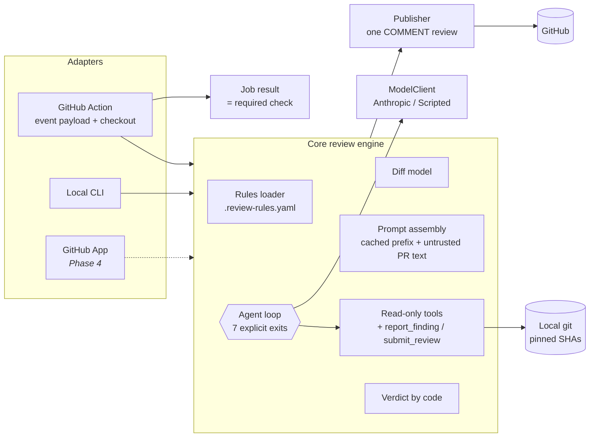

# Diffwise

An AI agent that reviews pull requests against rules defined in the target repo
(`.review-rules.yaml`). It posts one review with inline comments and a summary, and the
**verdict is computed by code**: any `blocking` finding fails the check, so branch protection
can block the merge.

It runs as a **GitHub Action** today; a **GitHub App** (webhook service) comes next. Both use
the same core engine as the local CLI.

**Live demo:** [gcsebas99/diffwise-demo](https://github.com/gcsebas99/diffwise-demo/pulls), six
seeded PRs, three blocked by Diffwise, one with a prompt injection it ignores.

<!-- Screenshots: a FAIL review with an inline comment (diffwise-demo#1), the blocked merge box,
     and the job summary page. -->

## How it works



1. **Rules** come from the target repo. Each has a severity (`blocking` / `advisory`) and either
   `check: llm` (the model judges it) or `check: deterministic:<name>` (code checks it, Phase 3).
2. **The agent loop** gives the model a map of the PR (files and the rules that apply), not the
   whole diff. It pulls hunks with tools, reads files or searches when a rule needs context, and
   calls `report_finding` for each violation. Code validates every finding: the rule must exist
   and apply to the file, and the line must be commentable in the diff.
3. **The loop always ends explicitly:** `submit_review`, or a step cap, token budget, deadline,
   stuck detection, a model that stops calling tools, or an API error. Only a submitted review
   is "complete"; anything else is `neutral`, never `pass`.
4. **The verdict:** a blocking finding → fail; incomplete → neutral; otherwise pass.
5. **The Action** posts one review pinned to the PR's head SHA, marks the previous Diffwise
   review outdated, writes annotations and a job summary, and fails the job on `fail`.

## Use it in a repo

`.github/workflows/review.yml`:

```yaml
on:
  pull_request:
    types: [opened, synchronize, reopened, labeled]

permissions:
  contents: read
  pull-requests: write

concurrency:
  group: diffwise-${{ github.event.pull_request.number }}
  cancel-in-progress: true

jobs:
  review:
    name: Diffwise review
    runs-on: ubuntu-latest
    timeout-minutes: 15
    steps:
      - uses: actions/checkout@v7
        with:
          fetch-depth: 0
          persist-credentials: false
      - uses: gcsebas99/diffwise@v0
        with:
          mode: ${{ contains(github.event.pull_request.labels.*.name, 'live-review') && 'live' || 'deterministic-only' }}
          anthropic-api-key: ${{ secrets.ANTHROPIC_API_KEY }}
          model: ${{ vars.DIFFWISE_MODEL }}
```

Then add the `ANTHROPIC_API_KEY` secret, a `DIFFWISE_MODEL` variable, a `live-review` label, and
require the `Diffwise review` check on `main`. A rules file looks like this:

```yaml
version: 1
rules:
  - id: route-needs-test
    title: API route changes need a test change
    severity: blocking
    applies_to: ["src/routes/**"]
    check: llm
    instructions: >
      If a route handler's behavior changes, the PR must add or change a test under test/routes/.
```

| Input | Default | Meaning |
|---|---|---|
| `mode` | `deterministic-only` | `live` runs the model; the default never spends money |
| `anthropic-api-key` | | from a secret; required in `live` mode |
| `model` | | Claude model ID; required in `live` mode |
| `github-token` | `${{ github.token }}` | needs `pull-requests: write` |

Outputs: `verdict` (`pass` / `fail` / `neutral`) and `review-url`.

## Safety and cost

- **`pull_request`, never `pull_request_target`.** Fork PRs get no secrets and a read-only token;
  the action refuses any other event.
- **Nothing from the PR is executed.** Tools only read git objects at pinned SHAs; git runs
  with argument arrays, never a shell.
- **PR text is untrusted.** It's wrapped in `<untrusted_*>` tags with closing tags escaped, and
  the model is told it's data. That lowers the odds of injection; the real limits are read-only
  tools and code-validated findings.
- **The bot never approves.** The review type only allows `COMMENT`; pass or fail is the
  required check.
- **Deterministic first.** Secrets and undocumented env vars are found by code on every PR, free
  and without the label; the model can't remove those findings. Secret findings name the kind
  and length, never the value. (In live mode the model still reads the diff, so a committed
  secret does reach the model provider: redaction protects Diffwise's outputs, not its input.)
- **Model output is escaped where it lands:** mentions are broken, HTML is shown as text.
- **Cost is opt-in twice:** the `live-review` label (triage access or higher) and a skip when no
  changed file has an LLM rule. Each review prints its model, prompt version, tokens and
  estimated cost. A review of the demo PRs costs $0.0004–$0.0014 on `claude-haiku-5-5`.

## Where each concept lives

Every concept is marked in the code with a `// [TAG]` comment explaining why it exists;
[`CONCEPTS.md`](CONCEPTS.md) lists them all with exact lines (`pnpm concepts` regenerates it).

| Concept | Files |
|---|---|
| Agent loop and its exits | [`src/core/loop.ts`](src/core/loop.ts) |
| Tools: Zod schemas, errors as values | [`src/core/tools/`](src/core/tools/) |
| Context: cached prompt, PR map, line-numbered diffs | [`src/core/prompt.ts`](src/core/prompt.ts), [`src/core/diff.ts`](src/core/diff.ts), [`src/core/tools/get-file-diff.ts`](src/core/tools/get-file-diff.ts) |
| Guardrails: untrusted input, verdict by code, safe git | [`src/core/verdict.ts`](src/core/verdict.ts), [`src/core/rules.ts`](src/core/rules.ts), [`src/core/local-git-source.ts`](src/core/local-git-source.ts), [`src/core/publish.ts`](src/core/publish.ts) |
| Observability: tokens, cost, prompt version | [`src/core/cost.ts`](src/core/cost.ts), [`src/model/types.ts`](src/model/types.ts) |
| Orchestration: one engine, swappable model and GitHub | [`src/core/engine.ts`](src/core/engine.ts), [`src/model/`](src/model/), [`src/adapters/github/`](src/adapters/github/) |
| GitHub API: reviews, pinning, pagination | [`src/adapters/github/`](src/adapters/github/), [`src/core/publish.ts`](src/core/publish.ts) |
| GitHub Actions: payload, label gate, job result | [`src/adapters/action/`](src/adapters/action/), [`action.yml`](action.yml) |

## Status

| Phase | | |
|---|---|---|
| 1 | Core engine + CLI | ✅ |
| 2 | GitHub Action + demo PRs | ✅ |
| 3 | Deterministic checks + evals (precision/recall per rule, replay in CI) | next |
| 4 | GitHub App on Render (webhooks, installation tokens, check runs) | |

Progress and lessons per sub-task: [`docs/PROGRESS.md`](docs/PROGRESS.md). Real runs:
[`docs/live-runs.md`](docs/live-runs.md).

## Development

Requires Node 22 and pnpm.

```sh
pnpm install
pnpm test && pnpm lint && pnpm typecheck
cp .env.example .env    # only for live runs: ANTHROPIC_API_KEY, DIFFWISE_MODEL
pnpm diffwise review --repo ../diffwise-demo --base main --head seed/route-without-test
pnpm build:action       # rebuild dist/index.js after changing src/ (CI checks it)
```

Unit tests never call the Anthropic or GitHub APIs: they use a scripted model, a fake GitHub
client and throwaway git repos.
